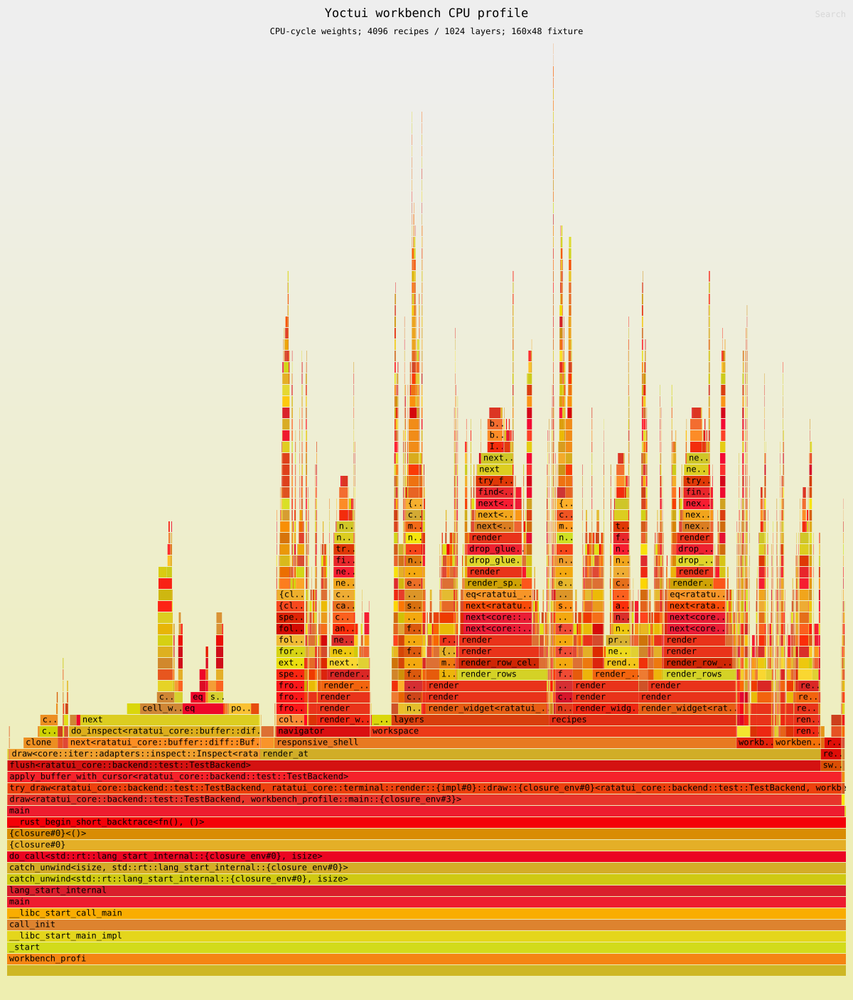

# Profiling

Use an optimized binary, exact source identity, and an explicit scenario.
[Performance](performance.md) defines limits; profiler timing is diagnostic.

| Purpose | Command |
| --- | --- |
| Renderer fixtures | `./scripts/profile-workload.sh` |
| UI/workbench ceilings | `./scripts/test-next-generation-ui-performance.sh`, `./scripts/test-workbench-ux-performance.sh` |
| Exact running processes | `./scripts/capture-runtime-profile.sh --help` |
| Flamegraph | `./scripts/flamegraph.sh`, then `./scripts/test-flamegraph.sh` |
| Memory policy | `./scripts/valgrind.sh`, then `python3 -m unittest scripts/test_valgrind_policy.py` |
| Live build | `./scripts/capture-real-poky-performance.py --help` |

## Renderer and process profiles

Renderer ceiling: 10,000,000 ns/frame; YOCTUI_UI_PERF_MAX_NS_PER_FRAME may lower it.
Cover idle/build/log/task/metadata/editor/graph/rootfs/terminal scenes. Allocate visible
rows; add caches only with measured invalidation/memory justification. Runtime profiles
record PID/source/binary/host/scenario, symbols, samples, unresolved weight, and hashes.

## Flamegraph

Install with `cargo install flamegraph --locked`; usable perf permissions are also
required. SVG and summary live in artifacts/flamegraph/; sampling/checksum checks apply.
Stored capture: **v0.1.353, 2026-10-18**, from clean runtime source
[3682a5fe](https://github.com/0xbadcaffe/yoctui/commit/3682a5fe4e9b0b5e52d045f78ad5b2995a6b9e1a).
It contains 6,000 frames, 2,749 real userspace samples, checksum
`7e8fe45e6dd05858`, and no unresolved or dropped stacks. The fixture alternates
4,096 recipes and 1,024 layers at 160×48, with frame pointers and 499 Hz
userspace sampling. Graph widths (including legacy `dominant_*_samples` fields)
represent CPU cycles, not the number of recorded samples; nested frames overlap.

[](../artifacts/flamegraph/yoctui.svg)

[Machine-readable summary](../artifacts/flamegraph/summary.txt).
YOCTUI_PROFILE_TARGET_DIR selects benchmark cache; YOCTUI_FLAMEGRAPH_BUILD_TARGET_DIR
isolates frame-pointer builds without changing acceptance.
The scripts reuse the private E2E benchmark target rather than also linking the
entire CLI. Raw trace, workload log, filter report and self-time report remain in
`target/ui-performance/flamegraph/`; the committed summary records binary,
workload, source, toolchain and host identity.

## Renderer hotspot fixes in 0.1.353

Four measured costs were reduced without persistent caches:

- Full-frame background styling uses a linear cell pass instead of repeated
  coordinate lookup. The dominant `Buffer::set_style` self-time fell from
  18.57% to 13.43% in the metadata profiles; remaining partial-area styling stays.
- Unfiltered Recipes, Layers and Devtool borrow their inventories and allocate
  only visible rows. Filtered queries are lowercased once and retain exact indices.
- The source editor skips already-scrolled nonwrapping rows before Ratatui's
  Unicode reflow. It still highlights preceding text for multiline syntax, and
  retains the original wrapping path when a row may wrap.
- The live diff summary reads only the requested changed rows, avoiding cloned
  history and save-preview hashing on every redraw. Explicit save previews and
  conflict checks still hash revisions. In the separate editor profiles, the
  dominant grapheme iterator's self-time fell from 33.95% to 1.83%.

Unprofiled paired medians on the same i7-8650U laptop, seven alternating pairs
of 500 frames per scenario, 128-frame warmups, 160×48 TestBackend:

| Scenario | Before ms/frame | After ms/frame | Reduction |
| --- | ---: | ---: | ---: |
| Idle | 0.642 | 0.618 | 3.76% |
| Active build | 0.858 | 0.908 | -5.86% |
| Large metadata | 0.904 | 0.832 | 8.03% |
| Log-heavy | 1.173 | 1.108 | 5.56% |
| Telemetry | 0.759 | 0.775 | -2.19% |
| Menu-heavy | 1.083 | 0.992 | 8.43% |
| Large rootfs | 2.152 | 2.115 | 1.71% |
| Large graph | 7.273 | 7.219 | 0.75% |
| Long editor | 22.053 | 8.471 | 61.59% |
| Dense terminal | 1.253 | 1.259 | -0.49% |

Positive reduction means faster; negative means slower. Small differences vary
on this shared host, so not every scene is claimed as a speedup. All paired
symbol checksums matched. Both A/B executables used v0.1.352 to keep version
glyphs identical; the optimized implementation was then bumped to v0.1.353.
Timing excludes fixture construction/startup but includes one end checksum per
run. No compiler or profiler ran in the comparison windows; QEMU stayed running.
The menu fixture uses a stable Dashboard background instead of an over-constrained
narrow Recipes table. Unstable earlier checksums were rejected.

[Raw samples, binary/source hashes and preliminary batch](performance/renderer-hotspots-0.1.353.json).
All 2,427 all-feature workspace tests passed (15 optional tests ignored), strict
Clippy passed, and all ten renderer ceiling checks passed below 10 ms/frame.
Version-only golden changes and regenerated README rasters were verified.
These fixtures do **not** establish live daemon CPU/latency or image-build performance.

For another comparison, preserve the baseline executable before rebuilding, then:

```bash
python3 scripts/measure-workbench-render.py \
  --baseline /absolute/path/to/baseline-bench \
  --candidate /absolute/path/to/optimized-bench --frames 500 --repeats 7
CARGO_BUILD_JOBS=2 ./scripts/flamegraph.sh
```

## Memory and live evidence

Valgrind compares 16/128-frame runs. Invalid accesses, definite/indirect leaks,
unknown stacks, growth, unexpected descriptors, or incomplete execution fail.
The only fixed-cache exception is ten pinned allocations: tui-logger 34,995 bytes
plus Jiff 4,372 bytes, maximum 39,367 bytes. check_valgrind.py pins sizes/stacks/
versions/checksums; categories cannot grow. Changes require separate review.

Live evidence needs exact initialized build/target/configuration, source/binary,
parallelism, sustained task interval, CPU/latency/memory, hashes, and freshness.
Measure CPU without Cargo/profiler sharing the window. Label partial builds;
fixtures and old captures cannot certify current performance or completed boot.
